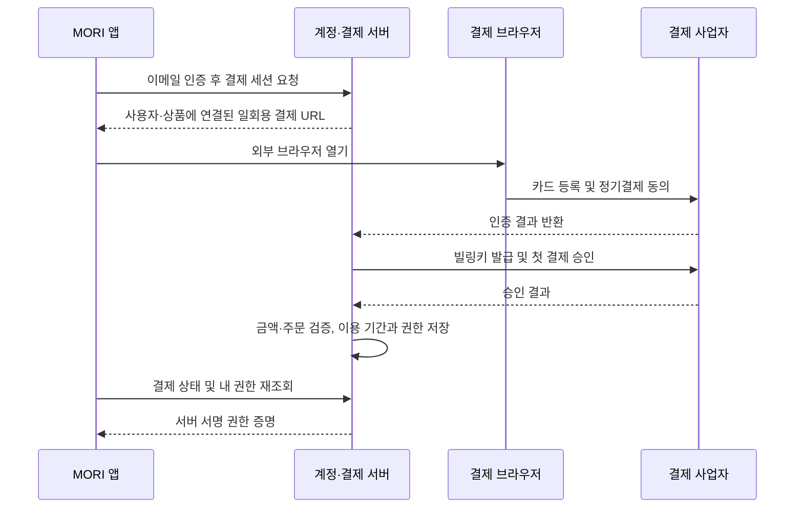

# MORI 월 2,900원 Pro · 계정과 정기결제 설계

작성: 2026-10-20. 상태: 구현 전 설계안. 기준 코드: `2ee3903`.

후속 구현: 계정·체험·기기·서명 권한·월 결제·갱신·해지·환불 요청과 앱 연결을 구현했다. 운영 계정·실제 PG·배포는 미연결이다. 아래는 설계 기준이며 실제 Node 서버·JSONB/CAS 저장·지원 범위와 설정 방법은 [구현·운영 연결 가이드](billing-implementation.md)를 따른다. 기본 빌드는 무료 베타를 유지한다.

사용자가 정한 상품은 **월 2,900원 정기결제**다. 이전의 일회성 49,000원과 월 4,900원·연 49,000원 가설을 대체한다. 가격·결제 주기를 제외한 아래 정책과 기술 선택은 개발을 위한 제안이며 사용자와 합의한 사실로 취급하지 않는다. 설계 기준 코드 `2ee3903`에는 계정·결제·체험 만료·Pro 권한 검사가 없었다. 후속 구현 상태는 위 가이드를 확인한다.

## 1. 상품과 범위

| 항목 | 설계 기준 | 결정 상태 |
|---|---|---|
| 상품 | MORI Pro 하나 | 제안 |
| 가격 | 월 2,900원 정기결제 | 사용자 지정 |
| 고객에게 표시할 금액 | 최종 청구 총액 2,900원. 추가 세금으로 표시 가격을 올리지 않는 안 | 제안. 실제 세무 처리는 판매 조건 확정 시 확인 |
| 청구 주기 | 첫 유료 결제일 기준 매월 자동 갱신 | 제안 |
| 무료 체험 | 계정당 한 번, 사용자가 시작한 시점부터 14일 | 제안 |
| 체험 카드 등록 | 불필요. 체험 종료 시 자동 결제하지 않음 | 제안 |
| 기기 | 개인 계정당 Mac 2대, 설정에서 해제·교체 | 제안 |
| 오프라인 | 마지막 검증 후 최대 7일, 실제 이용 종료 시각을 넘기지 않음 | 제안 |
| AI 이용료 | 사용자 Codex·Claude·OpenAI 이용권·API 비용 별도 | 기존 원칙 유지 |
| 초기 판매 범위 | 국내 카드·KRW, 앱 밖 브라우저 결제 | 기술 검토를 위한 가정 |
| 연간·평생·팀 요금제 | 첫 출시에서 판매하지 않음 | 제안 |

월 구독의 가치는 매주 반복하는 보고서 작성과 맞춤 업무 흐름이다. 일반 메모 편집을 구독 결제 이유로 삼지 않는다. iPhone·Sync·Team·자체 AI 크레딧은 포함하지 않으며 출시 예정 혜택으로 선판매하지 않는다.

### 무료와 Pro 경계

| 기능 | Free | 체험 / Pro |
|---|---|---|
| 메모 작성·검색·폴더·링크·기본 그래프 | 제공 | 제공 |
| 데일리·미완료 이월·현재 기본 연동 | 제공 | 제공 |
| 기존 단일 메모 AI 기능·기본 연결 스킬 | 기존 범위 유지, 외부 AI 비용 별도 | 동일 |
| 기간·자료 선택, 기본 양식으로 원문 모음 만들기 | 제공 | 제공 |
| 여러 기록으로 주간보고·스탠드업·회고 AI 생성 | Pro 안내와 14일 체험 진입 | 제공 |
| 사용자 보고서 템플릿 신규 저장·수정 | Pro 안내 | 제공 |
| 기존 템플릿 열람·삭제·파일 내보내기 | 제공 | 제공 |
| 기존 템플릿으로 로컬 원문 모음 만들기 | 제공 | 제공 |
| PDF·HTML 파일 내보내기 | 제공 | 제공 |
| 웹 공유 생성·업데이트 | Pro 안내 | 계정당 활성 링크 20개 |
| 자기 공유 링크 확인·중단 | 로그인 후 제공, 만료 후에도 가능 | 제공 |
| 기존 보고서·미리 생성한 초안의 편집·복사·저장·내보내기 | 제공 | 제공 |
| 향후 회의 준비·자동화 | 현재 상품 설명에 미포함 | 검증·구현 후 별도 안내 |

Pro의 보고서 실행에 별도 월별 횟수 과금은 두지 않는 안이다. 현재의 30개 기록·80,000자 입력 제한과 외부 AI 제공자의 한도는 유지한다. ‘AI 무제한 제공’이라고 광고하지 않는다.

### 현재 무료 베타 사용자

`0.9.0`의 보고서·템플릿은 제한 없는 무료 체험으로 배포된 상태다. 과금 설정을 원격에서 켜서 기존 설치본을 잠그지 않는다. 기존 배포본과 기록은 계속 사용할 수 있게 유지하고, 상용 정책을 적용하는 새 버전은 무료·유료 경계와 외부 AI 비용을 사전에 표시해 사용자가 선택해서 업데이트하게 한다. 자동 업데이트로 조용히 체험을 만료시키지 않는다.

이는 모든 미래 Pro 기능에 영구 무료 권리를 부여하는 정책은 아니다. 무료 베타 종료일·상용 버전 번호와 전환 안내는 배포 전에 정하며 현재 버전을 유료 상품이라고 표시하지 않는다.

## 2. 화면과 사용자 흐름

무료 시작은 지금처럼 설치 → 보관함 열기다. 계정 생성 화면을 먼저 띄우지 않는다.

```text
설정 > 계정 및 Pro
  무료 사용 중
  주간보고 AI 생성과 맞춤 템플릿 · 월 2,900원
  [14일 무료 체험] [Pro 구독하기] [구매 복원]
  AI 제공자 이용료는 별도입니다.

체험 중
  Pro 무료 체험 · YYYY-MM-DD HH:mm까지
  카드 등록 없음 · 자동 결제 없음
  [월 2,900원으로 구독]

구독 중
  MORI Pro · 월 2,900원
  다음 결제: YYYY-MM-DD HH:mm · 2,900원
  등록된 Mac: 1/2
  [결제수단 변경] [구독 해지] [기기 관리]

해지 예약
  YYYY-MM-DD HH:mm까지 Pro 사용 가능
  다음 자동 결제 없음
  [해지 예약 취소]
```

- ‘14일 무료 체험’을 누르면 이메일 코드로 로그인하고 체험 시작을 명시적으로 선택한다. 코드 발송만으로 체험이 시작되지 않는다.
- ‘Pro 구독하기’를 누르면 이메일 인증 → 가격·자동 갱신·AI 비용 안내 → 명시적 정기결제 동의 → 브라우저 결제로 진행한다.
- 체험 중 구독하면 첫 결제 즉시 유료 한 달이 시작되고 남은 무료 체험은 종료되는 안이다. 이 내용을 결제 직전에 표시한다.
- 생성 버튼을 눌렀는데 권한이 없으면 자료 선택을 유지한 채 Pro 안내를 연다. 로그인·결제 완료 후 AI를 자동 실행하지 않고 사용자가 다시 생성 버튼을 누른다.
- 구매 복원은 서버 권한을 다시 가져오는 동작이다. 재결제하거나 메모를 자동 업로드·복사하지 않는다.
- 해지는 설정에서 직접 처리한다. 설문 응답이나 고객센터 연락을 필수로 만들지 않는다. 해지와 환불은 별도 동작이다.



브라우저 성공 화면이나 앱 복귀 URL만으로 Pro를 켜지 않는다. 초기 버전은 앱 복귀 전용 딥링크 없이 ‘앱으로 돌아가 구매 확인’과 제한된 상태 조회로 동작할 수 있다. 인증된 앱은 상태를 2초 간격, 최대 60초 조회하고 이후 수동 확인을 제공한다. 타임아웃은 결제 실패로 단정하지 않는다.

## 3. 기술 구성과 사업자 후보

### 제안 구성

- 계정: Supabase Auth의 이메일 OTP. 이메일 템플릿을 코드 방식으로 구성하고 실제 발송용 SMTP·도메인을 준비한다.
- 데이터: Supabase Postgres. 결제·체험·권한·기기 데이터만 저장한다.
- API/작업자: Supabase Edge Functions와 DB의 예약 작업. 앱이 꺼져 있어도 청구와 대사가 실행돼야 한다.
- 결제: 국내 KRW 첫 출시를 가정해 토스페이먼츠 자동결제 결제창 방식을 우선 검토한다. 계약·수수료·사용 가능 결제수단 확인 전 확정 사업자로 표시하지 않는다.
- Electron main: 인증 토큰 저장, API 호출, 서명된 권한 검증과 기능 판정. renderer에는 화면에 필요한 계정·권한 상태만 노출한다.

정기결제는 PG가 자동으로 매달 실행하는 것으로 가정하면 안 된다. 토스페이먼츠는 빌링키 방식이며 판매자 서버가 원하는 주기에 승인을 요청해야 한다. 자동결제에는 추가 심사·계약이 필요하고, 확인한 V2 카드 등록 가이드는 국내 발급 카드만 지원한다. [공식 자동결제 연동 가이드](https://docs.tosspayments.com/guides/v2/billing/integration)

2,900원 소액 결제에서는 건당 고정 수수료가 중요하다. Paddle의 표준 공개 요율은 거래당 5% + US$0.50이며 US$10 미만 상품은 별도 가격 문의 대상이다. 이 요율을 MORI에 확정 적용하거나 환율을 가정해 순수익을 계산하지 않는다. 국내·해외 판매가 필요해지면 수수료와 운영 부담을 다시 비교한다. [Paddle 공식 가격](https://www.paddle.com/pricing)

이메일 코드 로그인과 예약 작업은 각각 [Supabase 이메일 인증 문서](https://supabase.com/docs/guides/auth/auth-email-passwordless), [Edge Functions 예약 문서](https://supabase.com/docs/guides/functions/schedule-functions)를 참고했다. 위 내용은 공급자 기능 확인이며 MORI 운영 계정·계약·배포가 완료됐다는 뜻이 아니다. 서버는 현재 저장소에 새로 구현해야 한다.

## 4. 데이터 모델

모든 시간은 DB에서 UTC로 저장한다. 결제 주기의 기준 시간대는 `Asia/Seoul`로 별도 저장한다. 이메일을 거래의 기본키로 사용하지 않는다.

| 테이블 | 주요 필드와 제약 |
|---|---|
| users | 내부 id, auth subject UNIQUE, 상태, 생성·삭제 요청 시각 |
| products | code=`mori_pro_monthly_v1`, amount=2900, currency=KRW, interval=month, 판매 활성 상태, 가격 정책 버전 |
| trial_grants | user_id UNIQUE, 시작·종료 시각, 동의한 정책 버전. 최초 시작을 트랜잭션으로 처리 |
| device_sessions | id, user_id, 기기 표시 이름, 공개키 또는 설치 식별자, 마지막 확인, 철회 시각. 하드웨어 지문은 수집하지 않음 |
| checkout_sessions | id, user_id, product code, purpose=purchase/update_method, device id, 만료·처리 상태, nonce 해시, 동의한 가격·조건 버전 |
| billing_customers | user_id, PG의 무작위 customerKey UNIQUE. 이메일이나 연속 번호를 사용하지 않음 |
| payment_methods | user_id, 암호화한 billingKey, 카드사·마지막 번호 등 PG가 허용한 최소 표시 정보, 상태 |
| subscriptions | id, user_id, product code, 상태, period_start/end, anchor_day/timezone, cancel_at_period_end, version. 활성 구독 중복 금지 |
| billing_cycles | subscription_id + cycle_index UNIQUE, 회차별 고정 금액·통화, 청구 상태, 처리 lease, 다음 재시도 시각 |
| payment_attempts | cycle_id, attempt_no, order_id UNIQUE, PG payment_key UNIQUE, idempotency_key UNIQUE, 승인·불명·실패·환불 상태 |
| billing_events | PG 이벤트 식별자 또는 검증한 중복 식별값 UNIQUE, 처리 상태, 수신·재처리 시각. 원본 민감 데이터 최소화 |
| entitlements | user_id + capability UNIQUE, 출처 trial/subscription, valid_until, revision, revoked_at |
| audit_events | 계정·권한·결제·해지·기기 변경의 ID·결과·시각. 코드·토큰·메모 본문 미포함 |

Supabase Auth의 subject를 내부 user_id와 명시적으로 연결한다. 이메일 변경 후에도 같은 user_id·구독을 유지한다. 같은 이메일을 가졌다는 이유로 다른 인증 계정을 자동 병합하지 않는다.

클라이언트가 결제·권한 테이블을 직접 변경할 수 없게 한다. 사용자 읽기는 자기 계정으로 제한하고, 서버의 관리 권한 키는 서버에만 둔다. 계정 삭제 시 청구를 먼저 중단하고, 보존해야 할 거래 기록과 삭제할 프로필·세션을 구분하는 실제 보존 정책은 판매 조건 검토 후 확정한다. 삭제 후 재가입으로 체험을 반복하는 문제를 막기 위해 무단 기기 추적을 도입하지 않는다.

## 5. API 계약 초안

아래 경로는 MORI 서버용 설계이며 공급자의 실제 API 경로를 뜻하지 않는다. 사용자 ID·가격·이용 기간은 요청 본문을 신뢰하지 않고 검증한 세션과 상품 테이블에서 정한다.

| 메서드·경로 | 입력 / 결과 / 규칙 |
|---|---|
| POST /auth/email-code | email → 일반화한 발송 결과. 재발송 제한·시도 제한·계정 열거 방지 |
| POST /auth/verify | email + code → 인증 세션. 토큰은 Electron main으로만 전달 |
| POST /auth/refresh | 안전하게 보관한 refresh token → 회전된 세션. 공급자 SDK의 갱신·폐기 계약 준수 |
| GET /me | 계정·체험·구독 요약, 서버 시각, 정책 버전 |
| POST /trials | 기기 세션 + 명시적 시작 → 기존 또는 새 체험. 중복 요청으로 기간 연장 금지 |
| POST /devices | 설치 등록 → device session. 2대 초과 시 교체 대상 선택 |
| DELETE /devices/:id | 본인 기기 철회. 새 증명 발급 중단 |
| GET /entitlements | 본인 기기 ID → 서명된 capability 증명 |
| POST /checkout-sessions | product code + 정책 동의 버전 + idempotency key → 일회용 브라우저 URL. 활성 구독이면 새 결제 대신 관리 화면 |
| GET /checkout-sessions/:id | 본인 세션의 pending/confirmed/failed/unknown. 다른 사용자는 접근 불가 |
| GET /billing/callback | PG 인증 결과 + 연결된 nonce → 서버가 일회 검증·소비. 로그인 이메일로 거래 연결 금지 |
| POST /subscriptions/:id/cancel | 갱신 중단. version 검사와 DB 잠금으로 청구 경합 처리 |
| POST /subscriptions/:id/resume | 아직 이용 기간이 남고 현재 청구가 확정된 해지 예약만 취소. 즉시 재결제하지 않음 |
| POST /payment-method-sessions | 본인 결제수단 교체용 브라우저 URL. 카드 교체 자체로 추가 과금 금지. callback도 purpose로 구분 |
| POST /refund-requests | 본인 거래 + 사유 → 접수 상태. 환불 완료를 먼저 표시하지 않음 |
| POST /webhooks/toss | 제한된 수신 크기·빈도, 내 거래 연결 검증, 저장 후 재처리. 클라이언트 사용자 세션 대신 PG 검증 사용 |

수동 구매 복원은 `/me`와 `/entitlements`를 갱신하며 새 주문을 만들지 않는다. 이메일 코드 만료·발송 간격·실패 횟수의 실제 값은 인증 공급자 설정에 맞춰 테스트하고 앱에 일치하게 표시한다.

브라우저 결제 URL은 짧은 수명·일회용이며 미리 저장한 user_id·product·동의 버전에 묶는다. 로그인 토큰을 URL에 넣지 않는다. `authKey`·nonce·토큰을 접근 로그에 남기지 않고, 인증 결과 수신 후 쿼리 없는 결과 화면으로 이동시킨다. 결제 URL은 서버가 발급한 허용된 HTTPS 호스트만 열 수 있다.

## 6. 정기 청구와 중복 방지

### 첫 결제

1. 이메일 인증과 정기결제 동의가 끝난 계정만 결제 세션을 만든다.
2. PG 카드 등록 결과를 받아 서버에서 연결된 customerKey·nonce·세션 만료·미소비 여부를 검증한다.
3. 서버에서 빌링키를 발급하고 암호화해 저장한다. 카드 등록 성공만으로 Pro를 활성화하지 않는다.
4. 최초 billing_cycle과 payment_attempt를 만든 뒤 2,900원 승인을 요청한다.
5. 서버 응답 또는 PG 거래 조회로 금액·통화·주문·최종 승인 상태를 확인한다. 성공한 거래에 대해서만 한 달 이용 기간과 권한을 원자적으로 기록한다.
6. 응답을 잃었으면 `unknown`으로 두고 같은 거래를 조회한다. 새 주문·새 멱등키로 다시 결제부터 하지 않는다.

### 월 갱신

예약 작업은 5분마다 실행하는 안이다. 앱 실행 여부와 무관하게 due 회차를 가져오고 DB 잠금·lease로 단일 작업자만 청구하도록 한다. 잠금 획득 뒤에도 해지·이미 승인된 회차·가격 버전을 다시 확인한다. 외부 호출 중에는 장시간 DB 트랜잭션을 유지하지 않는다.

월말은 최초 결제일의 anchor_day를 보존한다. 예를 들어 1월 31일 결제는 2월 말일, 다음에는 3월 31일 같은 기준 시각에 갱신한다. 금액은 30일 고정이 아니라 달력 기준 한 달이다. 경계는 `[period_start, period_end)`로 판정한다.

통신 재시도는 같은 attempt의 order_id와 멱등키를 재사용한다. 잔액 부족 등 **확정 실패**에 대한 새 청구 시도는 같은 cycle의 새 attempt로 기록하고, 이전 attempt의 성공 여부를 먼저 조회한다. 실패 후 24시간·72시간에 최대 두 번 재시도하는 안이며 사용자에게 다음 재시도와 해지 방법을 알린다. PG 멱등성 보존 기간에만 의존하지 않고 DB의 cycle·order·payment 키 제약으로 영구 중복을 막는다. 공급자 멱등키 계약은 구현 시 [공식 API 문서](https://docs.tosspayments.com/reference)로 다시 확인한다.

재시도 성공이 72시간 이내라면 원래 회차 종료일은 유지한다. 그 사이 접근이 중단될 수 있다는 점을 안내한다. 이후에는 자동 재시도를 종료하고 새 구독 동의를 받아 결제한 시점부터 새 이용 기간을 시작한다. 여러 달의 연체 금액을 한 번에 자동 청구하지 않는다.

### 웹훅과 대사

웹훅 본문에 담긴 성공·취소 상태를 그대로 권한으로 반영하지 않는다. 공급자가 제공하는 검증 수단을 적용하고, 서버에 저장된 내 주문과 연결한 뒤 서버 자격증명으로 PG 거래를 조회해 최종 상태를 대사한다. 실제 공급자 문서에 없는 서명 헤더를 임의로 가정하지 않는다.

중복 이벤트는 한 번 처리한다. 순서가 뒤집혀 과거 성공 이벤트가 늦게 와도 현재 환불된 거래를 다시 활성화하지 않는다. 수신 기록을 내구성 있게 저장한 뒤 응답하고 실패한 처리는 재실행한다. `unknown` 거래와 승인됐으나 권한 반영이 실패한 건은 주기적으로 조회해 복구한다. 지연 때문에 사용자에게 재결제를 먼저 권하지 않는다.

## 7. 권한·오프라인·해지 상태

권한은 화면의 `isPro` 값으로 결정하지 않는다. 서버가 `sub`, `device_id`, `aud`, `capabilities`, `grant_source`, `valid_until`, `iat`, `exp`, `revision`, `kid`를 담은 비대칭 서명 증명을 발급한다. 서명키는 서버에, 검증 공개키는 앱에 둔다. 표준 서명 라이브러리를 사용하고 알고리즘·issuer·audience·기기·계정·시간을 모두 검증한다.

증명 만료는 `min(서버 현재 시각 + 7일, 실제 체험 또는 유료 이용 종료 시각)`이다. 새 활성화·체험 시작·기기 등록은 온라인에서만 가능하다. 유효한 증명은 정상 세션의 네트워크 장애 동안 사용할 수 있지만, 명시적 로그아웃·다른 계정 로그인에서는 현재 계정 증명을 해제한다. refresh token 만료만으로 사용자 메모를 잠그지 않는다.

앱 시작과 이후 온라인 사용 중 24시간마다 갱신한다. 환불·기기 철회·계정 삭제가 오프라인 기기에 즉시 전달되지는 않으며 최대 7일 지연될 수 있다. 이는 초기 로컬 앱의 명시적 절충이다. 서버 시각과 마지막 검증 시각을 기록해 단순 시계 역행은 재인증을 요청하되, 공개 클라이언트의 변조를 완전히 방지한다고 주장하지 않는다.

| 상태 | 신규 Pro 실행 | 기존 기록·이미 생성한 결과 | 결제 동작 |
|---|---|---|---|
| Free / 체험 종료 | 중단, 체험 또는 구독 안내 | 계속 읽기·편집·저장·내보내기 | 자동 결제 없음 |
| Trial | 종료 시각까지 허용 | 유지 | 자동 결제 없음 |
| Active | 유효 증명 범위에서 허용 | 유지 | 다음 회차 예약 |
| 해지 예약 | 이미 결제한 종료 시각까지 허용 | 유지 | 다음 회차 청구 안 함 |
| 갱신 실패 / past_due | 기존 결제 기간 종료까지만 허용 | 유지 | 고지한 재시도만 실행 |
| 결제 결과 unknown | 기존 유효 권한만 유지 | 유지 | 대사 우선, 중복 청구 금지 |
| 전체 환불 확인 | 온라인 갱신 시 신규 Pro 중단 | 유지 | 자동 갱신도 중단 |
| 오프라인 증명 만료 | 온라인 확인 요청 | 유지 | 앱이 직접 청구하지 않음 |

신규 Pro 작업은 **실행 시작 때** 권한을 판정한다. 유효할 때 시작한 AI 생성이 도중에 기간을 넘겼다면 결과를 버리지 않고 완료·복사·저장하게 한다. 모델 실패·취소는 결제나 체험 기간을 변경하지 않는다.

해지 요청과 청구가 동시에 오면 subscription version과 row lock으로 순서를 정한다. 외부 승인 요청이 아직 나가지 않았다면 해지를 확정하고 청구를 금지한다. 이미 요청이 전송됐다면 ‘이번 결제 확인 중·다음 갱신 중단 요청 접수’로 표시하고 결과를 대사한 뒤 다음 회차 해지를 확정한다. 완료되지 않은 취소를 ‘이번 결제도 취소됨’으로 표시하지 않는다.

환불의 금액·기간·디지털 콘텐츠 이용 조건은 별도 판매 정책으로 출시 전 확정한다. 기술 구현은 접수 → PG 취소 요청 → 최종 상태 확인 → 권한·갱신 조정 순서다. 부분 환불·분쟁은 지원 처리 대상으로 보내며 전체 환불과 동일하게 무조건 권한을 박탈하지 않는다. 계정 삭제도 청구 중단과 진행 중 거래 대사를 선행한다.

## 8. 현재 코드에 붙일 위치

| 위치 | 구현할 책임 |
|---|---|
| shared/billing.ts (신규) | 상품 코드, capability, 계정·구독·표시 상태 타입. 비밀키 없음 |
| electron/auth/session-store.ts (신규) | main 전용 세션. safeStorage로 암호화하고 `userData/auth`에 저장. Vault와 백업에 넣지 않음 |
| electron/billing/billing-client.ts (신규) | 서버 통신·타임아웃·재조회·허용 결제 URL 확인 |
| electron/billing/entitlement-service.ts (신규) | 서명 검증·권한 캐시·기기 등록·계정 격리·오프라인 판정 |
| electron/main.ts의 report-generate | `ai=true`일 때 `reports.ai_generate` 검사. 자료 수집·원문 모음은 무료 |
| report-template-save | 신규 저장·수정에 `reports.template_write` 검사 |
| report-templates / report-template-delete | 읽기·삭제는 계속 무료 |
| report-save / report-copy / report-export | 기존 초안과 결과는 권한 만료 후에도 사용 가능 |
| src/app/AccountSettings.tsx (신규) | 무료·체험·구독·해지·결제 실패·기기 상태와 복원 |
| src/app/ReportDialog.tsx | 기능 선택을 유지한 Pro 안내. renderer 검사는 UX용이며 main에서도 반드시 검사 |
| shared/types.ts / electron/preload.ts | 최소 계정·결제 IPC 계약. refresh token이나 billingKey는 노출하지 않음 |
| 서버 프로젝트 (신규) | 위 API, DB migration, 예약 청구·웹훅·대사, 비밀과 서명키 관리 |

기본 AI 요약·초안·연결 스킬 경로에는 새로운 Pro 검사를 추가하지 않는다. 보고서 생성에 사용하는 기존 AI 실행기와 사용자 키를 재사용하며 AI 요청을 MORI 계정 서버로 우회시키지 않는다. 계정·결제 API에는 메모 제목·본문·폴더·생성 결과를 보내지 않는다. 후속 문서 공유 기능은 사용자가 확인·동의한 제목·본문 복사본만 별도 공유 API로 전송한다. [공유 범위](document-sharing.md)를 따른다.

현재 템플릿은 보관함 로컬 데이터다. 계정이 바뀌어도 템플릿 파일을 삭제하거나 다른 계정에 업로드하지 않는다. 기기 등록은 앱 이용권만 복원하고 보관함 동기화·외부 서비스 토큰 동기화는 하지 않는다.

## 9. 비용과 확인 지표

2,900원은 AI 원가를 MORI가 부담하지 않는 조건의 시작 가격이다. 호스팅·DB·이메일·결제·지원 비용은 여전히 발생한다. 사용자가 기존 AI 계정 없이 바로 생성할 수 있는 상품으로 표현하지 않는다.

| 유료 사용자 | 월 고객 청구 총액 |
|---|---:|
| 100명 | 290,000원 |
| 500명 | 1,450,000원 |
| 1,000명 | 2,900,000원 |

위 금액은 순수익이 아니며 세금·PG 수수료·환불·서버·지원 비용 차감 전이다. 실제 PG 견적과 운영 서비스 요금을 입력해 `월 청구 총액 - 결제 비용 - 환불 - 고정 운영비 - 변동 운영비`를 따로 계산한다. 금액이 작으므로 고정 거래 수수료와 월 최소 비용을 먼저 확인한다.

초기에는 체험 시작 수, 체험 계정 중 첫 승인 전환, 2회차 갱신율, 결제 실패·환불·해지 사유를 집계한다. 생성 횟수나 메모 내용은 계정·결제 분석에 자동 수집하지 않는다. 보고서 유용성은 동의한 사용자 인터뷰로 확인한다. 과금 전환과 갱신율은 관찰 기간이 끝난 코호트로 계산한다.

## 10. 개발 순서와 완료 기준

1. **정책·계약 준비:** 이 설계의 제안 정책을 검토하고 판매 지역·환불·개인정보·사업자 정보·PG 조건을 확정한다. 소비자에게 보이는 2,900원과 실제 청구 총액을 일치시킨다. 서명·공증·지원 안내 등 실제 배포 조건도 확인한다.
2. **계정·체험:** 이메일 코드 인증, 기기 등록, 계정당 한 번 14일 체험, main 권한 판정. 이 단계는 실결제 없이 검증한다.
3. **결제 테스트 환경:** 카드 등록, 첫 2,900원 승인, 서버 권한 반영, 구매 복원, 브라우저 완료·실패·지연 처리.
4. **갱신·해지·환불:** 예약 청구, 같은 회차 중복 방지, 확정 실패 재시도, unknown 대사, 카드 교체, 해지와 청구 경합, 환불 반영.
5. **상용 앱 연결:** 서명된 오프라인 증명, 2대 기기 관리, 계정 격리, 기존 무료 베타 전환 안내, 판매 문구와 실제 기능 일치.
6. **소규모 유료 출시:** PG 실운영 계약·키 분리·운영 알림·지원·거래 대사 확인 후 열고 첫 달과 갱신 회차를 직접 확인한다.

필수 검증 사례:

- 같은 계정에서 두 기기가 동시에 체험을 시작해도 종료일이 하나이며 재로그인으로 연장되지 않는다.
- 코드 재사용·인증 실패 제한·만료·이메일 변경·잘못된 계정 복원을 처리한다.
- renderer에서 Pro 플래그를 바꿔도 main이 신규 Pro 실행을 허용하지 않는다.
- 브라우저 완료 URL만 호출하거나 금액·상품·주문 ID를 바꿔도 권한이 생기지 않는다.
- 앱이 꺼져 있어도 갱신되고, 두 작업자가 같은 회차를 동시에 처리해도 한 번만 승인된다.
- 최초 승인 성공 후 DB 반영 실패, 응답 유실, 중복·역순 웹훅을 대사로 복구한다.
- 1월 31일·윤년·월말·UTC/KST 경계·체험 종료 정확한 시각을 검증한다.
- 해지·갱신·카드 교체·계정 삭제 경합에서 이중 청구하거나 종료 후 청구하지 않는다.
- 오프라인·서명 변조·키 교체·시계 역행·다른 계정·다른 기기의 증명을 구분한다.
- 체험·구독 만료 뒤에도 기존 메모·보고서·템플릿 열람, 결과 편집·복사·저장·내보내기는 가능하다.
- 결제·인증 로그와 보관함 백업에 메모 본문·refresh token·billingKey·인증 코드가 들어가지 않는다.

가격과 월 결제는 사용자 지정이다. 14일·2대·7일 정책, 공급자와 배포 구성, 재시도 정책은 제안이다. 실결제 공개 전 별도 확정이 필요한 사항은 PG 계약·정확한 수수료, 실제 판매·환불·보존 조건, 상용 전환 일정이다. 이 문서 작성으로 배포·실결제·자동 결제가 시작되지는 않는다.
